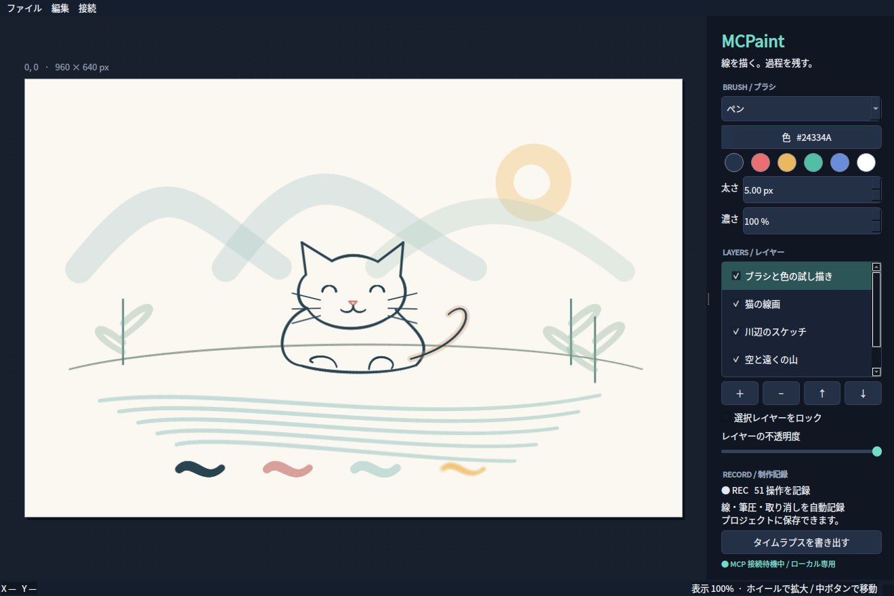

# MCPaint

Windows PC上で動く、MCP対応のペイントアプリです。人が手で描く場合も、CodexなどのAIが操作する場合も、同じキャンバスとレイヤーを使います。AIは操作後の画像を見ながら次の線を計画できます。



## ダウンロードして起動

1. GitHub Releasesから `MCPaint-0.3.0-windows-x64.zip` をダウンロードします。
2. ZIP全体を任意のフォルダーに展開します。
3. `MCPaint.exe` をダブルクリックします。

Windows 10/11の64bit版が対象です。PythonやFFmpegのインストールは不要です。`_internal` は実行に必要なので、EXEだけを移動せずフォルダー全体を保持してください。現時点の配布版はコード署名していません。

## 描く・保存する

- ペン、鉛筆、マーカー、エアブラシ、消しゴム、水彩、飛沫、ぼかし、色混ぜを選択できます。
- 色、太さ、濃さを変更できます。ペンタブレットの筆圧に対応します。
- 最大64レイヤー。フォルダー、複製・統合、クリッピング、透明ピクセルのロック、マスク、13種類の合成モードを扱えます。
- 長方形・楕円・投げ縄・自動選択、選択の反転・追加・削除・拡張・縮小・境界ぼかしに対応します。
- 別レイヤーを参照する塗りつぶし、色の誤差、すきま閉じ、領域拡張、囲って閉領域を塗る操作を使えます。
- 図形・ベジェ曲線、グラデーション、スポイト、画像読み込み、選択範囲・レイヤーの移動・回転・拡縮・傾き・メッシュ変形を扱えます。
- PNG/JPGを独立したレイヤーとして読み込めます。参考画像は背面・不透明度50%・ロック付きで追加し、その上のレイヤーで線を引けます。
- 色相・彩度、明るさ・コントラスト、カラーバランス、トーンカーブ、グラデーションマップを、補正レイヤーまたはピクセルへの適用として使えます。
- `Ctrl+Z`で取り消し、`Ctrl+Y`でやり直し。ホイールで拡大、中ボタンで表示位置を移動します。
- `.mcpaint`に、編集可能なレイヤーと制作履歴を保存できます。
- PNGに完成画像、MP4/GIFにタイムラプスを書き出せます。MCPでは背景透過PNGも出力できます。

制作過程は起動中ずっと自動記録します。ストロークごとの座標、筆圧、経過時間、レイヤー操作、取り消し・やり直しを保存します。タイムラプスはこの記録を再描画して生成します。デスクトップ全体の画面録画ではありません。待ち時間を圧縮し、線が伸びる途中も再生します。

現在の編集内容はユーザーホームの `.mcpaint/autosave.mcpaint` に自動保存され、次回起動時に復元します。新規作成や別プロジェクトを開く際は、前の作品を `.mcpaint/checkpoints/` に退避します。通常のプロジェクト保存も併用してください。

## Codexから使う

Windows側のCodex CLIで、展開したフォルダーを指定して登録します。

```powershell
codex mcp add mcpaint -- "C:\Tools\MCPaint\MCPaint-MCP.exe"
```

新しいCodexセッションを開き、例えば次のように依頼します。

> MCPaintの画面を見て、青いペンで猫を描いて。線を少し描くごとに返された画像を確認し、最後にプロジェクトとPNGとタイムラプスを保存して。

アプリが起動していなければ、MCP接続時の最初の操作で起動します。詳しい設定、WSL、他のMCPクライアントについては [docs/mcp-setup.md](docs/mcp-setup.md) を参照してください。34個のMCPツールは、すべて状態とPNG画像を返します。[作画解説との照合・AI作画手順](docs/illustration-workflow.md)に、参照した解説、追加機能、検証方法をまとめています。

参考画像を使う場合は［画像］→［参考画像を背面に読み込む…］を選びます。現在の描画レイヤーが選択されたまま、その後ろに参考画像が入ります。描き終えたら、レイヤー一覧で参考画像のチェックを外して非表示にします。[参考画像の操作とMCPの例](docs/reference-images.md)も参照してください。

`examples/illustration.mcpaint`には、MCPだけで描いた作例と編集履歴が入っています。同じフォルダーに完成PNGとタイムラプスMP4もあります。[scripts/illustration_demo.py](scripts/illustration_demo.py)で、線画、参照塗り、クリッピング、陰影、マスク、補正を順に実行できます。

## 開発

```bash
uv sync --frozen --extra dev
uv run python -m mcpaint
uv run python -m mcpaint --mcp
uv run pytest -q
uv run ruff check src tests scripts
```

Linuxのヘッドレス環境でテストする場合は `QT_QPA_PLATFORM=offscreen` を指定してください。

Windowsで `uv run python -m PyInstaller --noconfirm MCPaint.spec` を実行すると配布用フォルダーを生成します。GitHubのmainへコードを登録すると、ActionsがWindows上でテスト、ビルド、EXEの起動検査を行い、パッケージの版番号に対応するReleaseへ公開します。既存Releaseは書き換えません。新しい公開版では、`pyproject.toml`と`src/mcpaint/__init__.py`の版番号を更新してください。

## 現在の範囲

キャンバスは最大4096×4096px、レイヤーは64枚、1本の線は最大20,000点です。タイムラプス出力は最長360フレーム・長辺960pxで、録画時間を圧縮します。PSD/CLIP形式、ベクターレイヤー、3Dモデル、テキスト、独自ブラシ資産の読み込みには対応していません。0.1.0/0.2.0のプロジェクトは読み込めます。0.3.0で保存したプロジェクトは0.3.0以降で開いてください。

MCPはstdio経由で、同じPCのGUIへ認証付きlocalhost接続を使います。外部ホストへの通信は行いません。標準のWeb版ChatGPTからPC内のstdioサーバーへ直接接続する設定は、このアプリに含まれていません。
